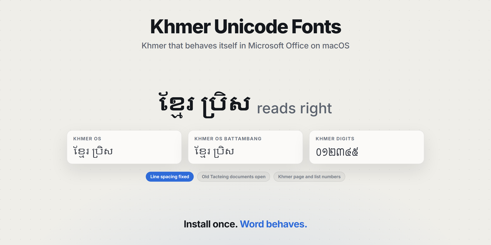

# Khmer Unicode Fonts

**Khmer Unicode fonts that behave themselves in Microsoft Office on macOS: fixed line spacing, old Tacteing documents, and Khmer page and list numbers.**

<picture>
  <source media="(prefers-color-scheme: dark)" srcset="art/banner-dark.png">
  
</picture>

Khmer Unicode Fonts Support MS Office in Mac OS

- Fixed line spacing
- Fixed Tactieng font in old document on Mac's MS Word
- Automatic number in khmer eg: Page number and List number
